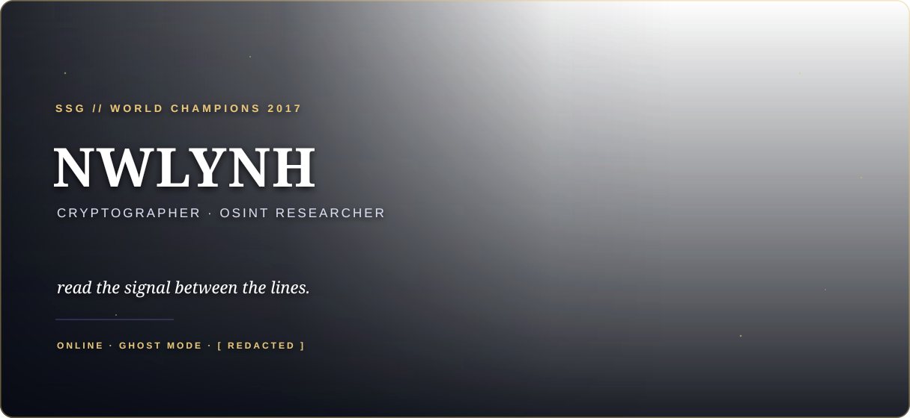

 

 

## About

I explore the space where cryptography, intelligence and adversarial thinking meet. Every repository is an archive; every challenge is a signal waiting to be decoded.

`cryptography` · `osint` · `ctf` · `research`

 

 

## Tần suất làm việc

